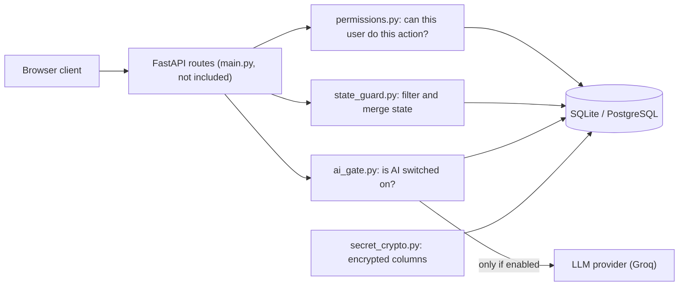
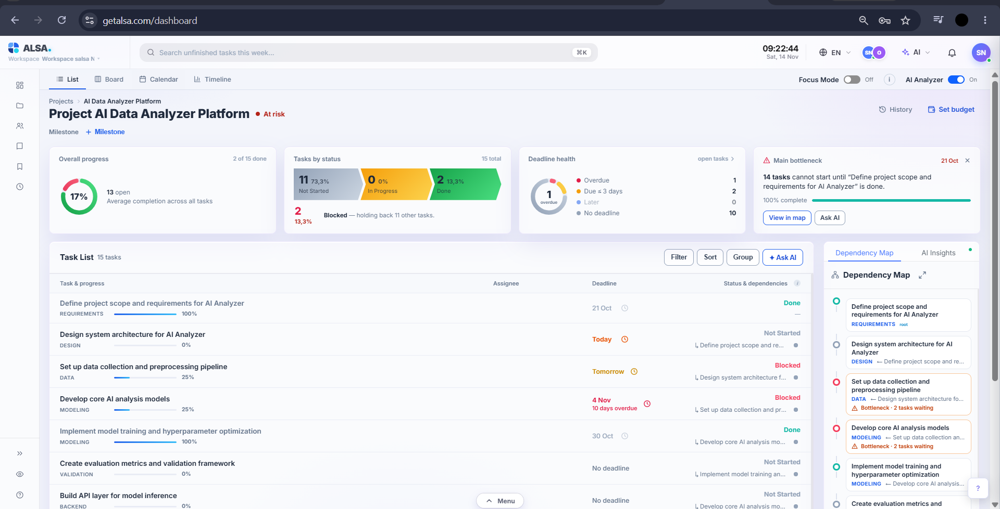
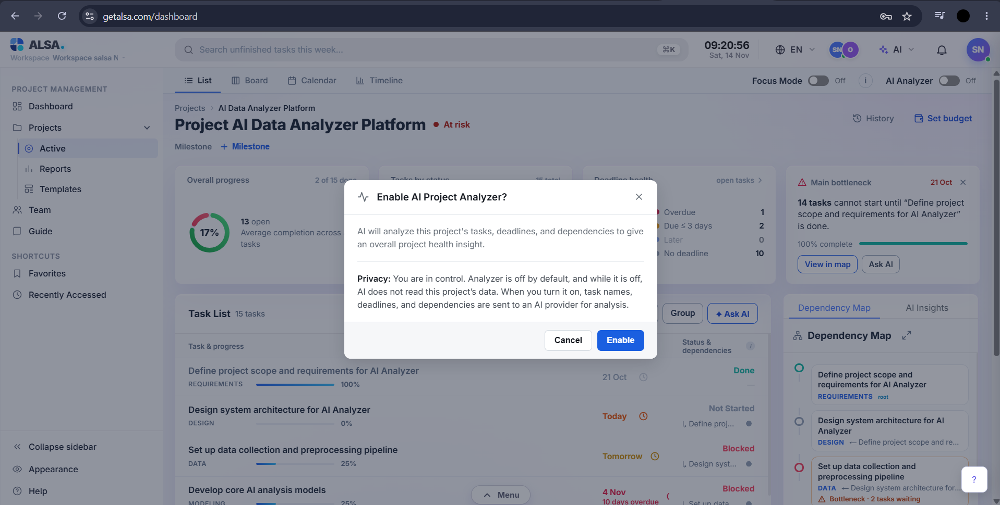
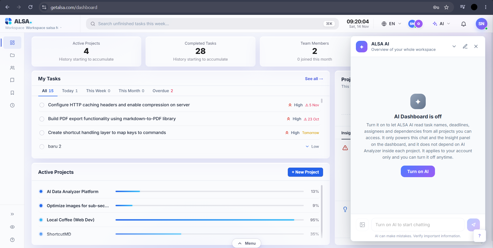

# ALSA: architecture showcase

ALSA is an AI-native project management web application, built solo by a student developer using AI-assisted development over roughly five to six months.

This repository is a **curated excerpt** of the backend: the parts that show how the system handles access control, data safety and AI privacy. The full application is private.

| | |
|---|---|
| Backend | FastAPI, 111 routes, 31 database tables |
| Database | SQLite for local development, PostgreSQL (Supabase) in production |
| AI | LLM calls through Groq, always behind an opt-in gate |
| Frontend | Vanilla JavaScript, single file, interface in 8 languages |
| Deployment | Render, via the dashboard (no CI/CD pipeline) |

## What is in this repository

```
src/
  models.py          All 31 tables (SQLAlchemy)
  database.py        Engine setup and production safety guard
  permissions.py     Two-layer role-based access control
  project_access.py  Endpoints that grant, change and revoke project access
  state_guard.py     Per-project filtering and merging of the shared state blob, plus safety snapshots
  ai_gate.py         Server-side opt-in gate for every AI feature
  secret_crypto.py   Transparent encryption for integration tokens and chat history
  html_sanitizer.py  Allow-list HTML sanitizer for rich text
tests/
  test_permissions.py
  test_state_guard.py
```

**Not included:** `main.py` (the route layer), the automation and report engines, the AI prompts, and the frontend. Those hold core product logic.

## Architecture



## Screenshots


*Project view: task status, deadline health, bottleneck detection and dependency map.*


*AI is off by default. Turning it on requires explicit consent, and the server checks the switch before any data is sent.*


*The dashboard AI chat has its own per-user switch, independent from the per-project Analyzer.*

## Design decisions

### 1. Two-layer access control (`permissions.py`, `project_access.py`)

- **Layer one, workspace role:** `owner`, `admin` or `member`. Owners and admins are automatically `manager` on every project.
- **Layer two, per-project level** for regular members: `viewer`, `editor` or `manager`. A member with no row for a project has no access to it at all.
- Endpoints check an **action** (`view`, `edit`, `delete`, `manage_access`), never a role name. Adding a new level means adding one entry to a dictionary, with no endpoint changes.
- **Fail-closed:** an unknown level, an unknown action or a non-member is denied.
- Every grant, change and revoke is written to an **audit log** inside the same transaction as the change itself.

### 2. Per-project permissions inside a single JSON state blob (`state_guard.py`)

The dashboard state is one JSON blob per workspace that holds every project. Rather than restructure the data, `state_guard.py` enforces permissions on the blob:

- `filter_state_for_member` returns only the projects a member may see.
- `merge_member_payload` merges what a member submits with the full server copy. Hidden projects cannot be overwritten or deleted, edits to `viewer`-level projects are discarded, and members cannot delete projects through the state endpoint.
- `restore_disappeared_projects` applies the same protection to owners and admins. A project that vanishes from a payload is far more likely to be a stale browser tab than an intentional delete, so it is restored. Deliberate deletion goes through a dedicated endpoint.
- Before any save that removes a project, a **snapshot** of the blob is stored (the latest 30 per workspace are kept), and a restore function can bring deleted projects back without overwriting newer changes.

### 3. AI that is off by default and fails closed (`ai_gate.py`)

- The on/off state lives on the **server**, not in the browser. The browser only displays it.
- Default is **off**. No row means off.
- The check runs **before the prompt is assembled**, not through instructions inside the prompt. When AI is off, no task names, deadlines, assignees or activity logs reach the provider.
- Two independent switches: per project (the AI Analyzer) and per user (the dashboard AI chat). Neither enables the other.

### 4. Secrets encrypted at rest (`secret_crypto.py`)

- A custom SQLAlchemy column type, `EncryptedText`, encrypts with Fernet and stores values with an `enc1:` prefix. Application code reads and writes plain text.
- Writes **fail closed**: without a key, a write is rejected rather than stored in plain text. Legacy plain-text rows still read correctly, so migration is gradual.
- If the key is lost or changed, reading a row does not crash the request. The integration is marked `error` so the UI asks the user to reconnect.
- Secret values never appear in error messages.

### 5. Defensive details

- **Production guard (`database.py`):** on the hosting platform, a missing `DATABASE_URL` stops the server from starting instead of silently creating an empty SQLite file that would be wiped on every deploy.
- **Connection timeouts and pool settings** so a paused or slow database produces a fast error rather than a frozen dashboard.
- **SQLite in WAL mode** so a long read does not block writers during local development.
- **Optimistic locking** on shared notes: a version number must match on save, otherwise the server answers 409.
- **HTML sanitizer (`html_sanitizer.py`)** uses an allow-list for tags, attributes and CSS, and only the Python standard library, to prevent stored XSS in rich-text content.

## Running the tests

The two tests in this repository are self-contained. They need Python 3 and the packages the modules import (`fastapi`, `sqlalchemy`, `cryptography`).

```
# Windows PowerShell
$env:PYTHONPATH = "src"
python tests\test_permissions.py
python tests\test_state_guard.py

# macOS / Linux
PYTHONPATH=src python tests/test_permissions.py
PYTHONPATH=src python tests/test_state_guard.py
```

Each prints `ALL TESTS PASSED` on success and exits with a non-zero status if any check fails.

**What is not here:** the tests for the project-access endpoints exercise the full application, including `main.py`, so they live in the private repository and are not part of this excerpt.

## About the development process

ALSA was built by one person with AI assistance. The architecture decisions above, such as why the AI gate fails closed and why the state guard restores missing projects, are the part I can explain and defend in detail.